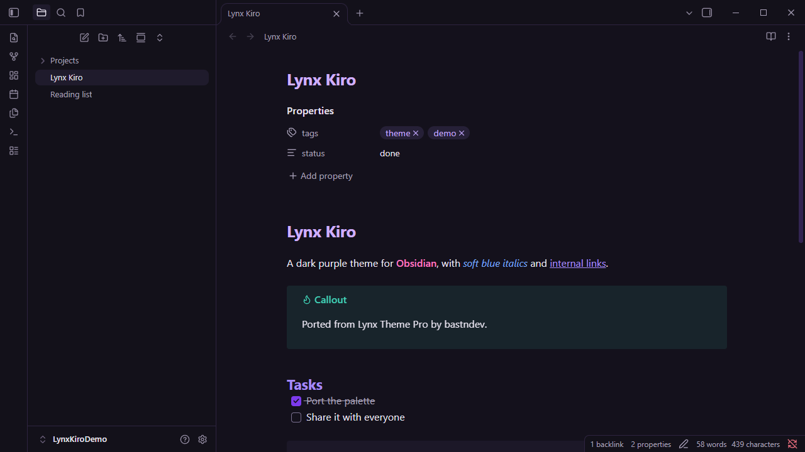
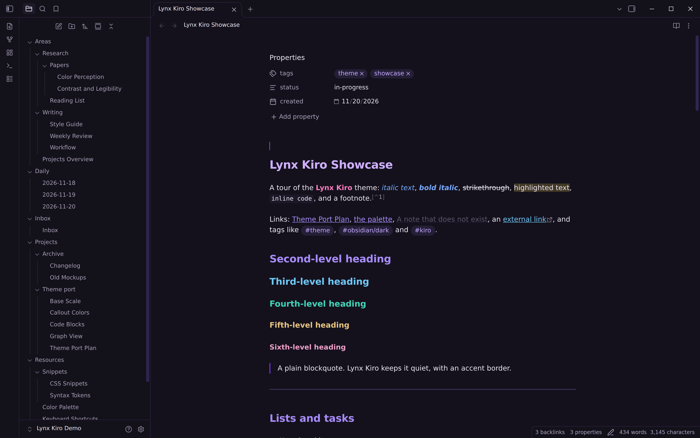
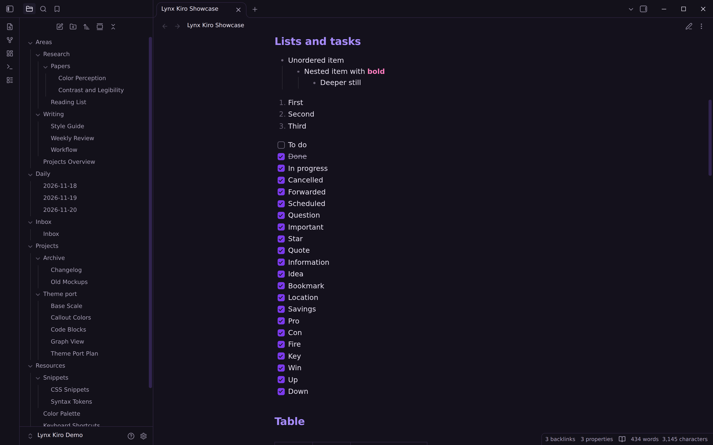
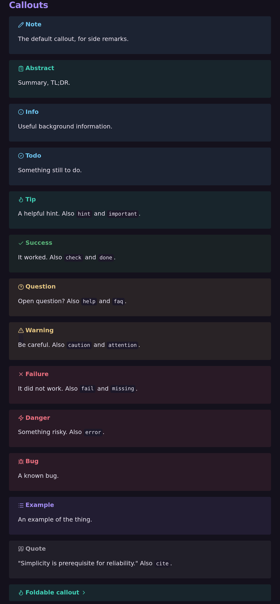
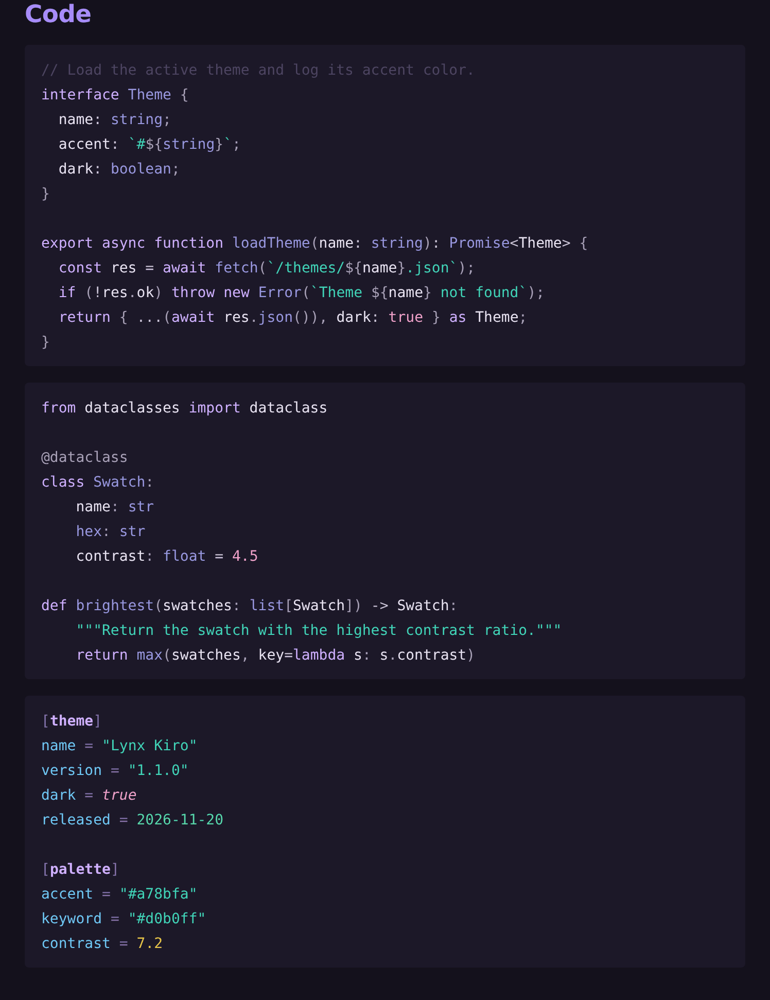
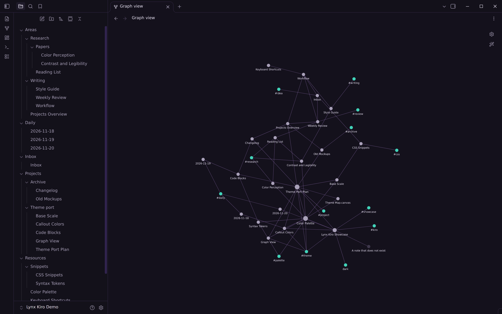
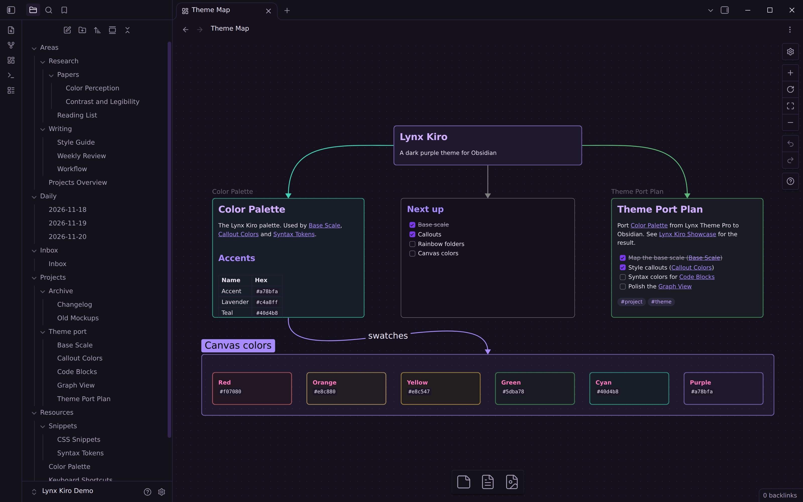
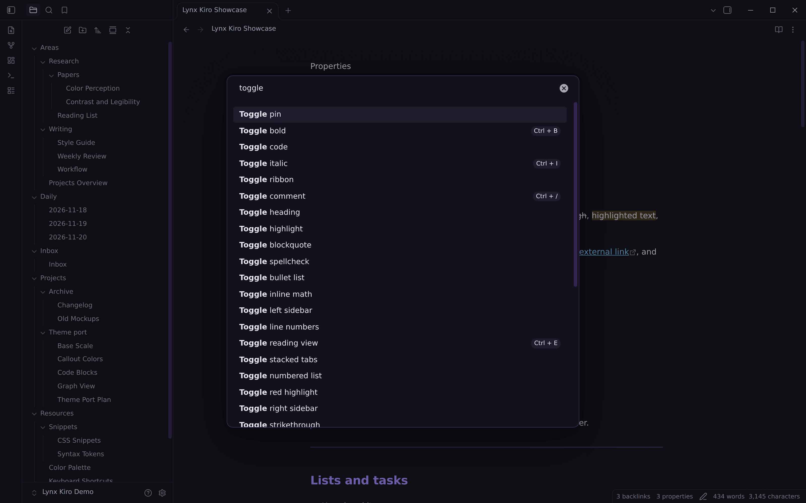
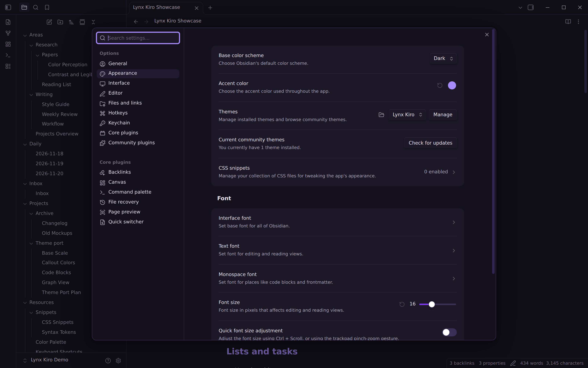

# Lynx Kiro for Obsidian

A dark purple Obsidian theme, ported from the **Lynx Kiro** variant of [Lynx Theme Pro](https://github.com/bastndev/Lynx-Theme-Pro) by [bastndev](https://github.com/bastndev).

Dark mode only.

## Screenshots

Captured from a real Obsidian with the [demo vault](demo-vault); see [scripts/screenshots](scripts/screenshots) to regenerate them.

| Live Preview | Reading view |
| :---: | :---: |
|  |  |
| **Callouts** | **Code blocks** |
|  |  |
| **Graph view** | **Canvas** |
|  |  |
| **Command palette** | **Settings** |
|  |  |

## Install

1. Download `theme.css` and `manifest.json` from this repo (or the latest release).
2. Put them in `<your vault>/.obsidian/themes/Lynx Kiro/`.
3. In Obsidian: **Settings → Appearance → Themes → Lynx Kiro**, and switch to dark mode.

## Contributing

Issues and pull requests are welcome. See [CONTRIBUTING.md](CONTRIBUTING.md).

## Credits

- Original palette and design: **Lynx Theme Pro** (the `Lynx Kiro` theme) by Gohit X ([bastndev](https://github.com/bastndev/Lynx-Theme-Pro)), MIT licensed. This repo is an Obsidian port of that work.
- Kiro is a product of Amazon Web Services. This theme is a fan-made port and is not affiliated with or endorsed by Kiro, AWS, or bastndev.

## License

MIT. See [LICENSE](LICENSE); it keeps the original Lynx Theme Pro copyright notice.
